<!-- _class: lead -->

# Phase 0: Command Line Podcast Search
### Discovery → (Audio Download) → Transcripts → Chunks → Embeddings → Vector Search


CSSE 417 · Project 1: Podcast Agent

<!--
Running examples: Tech Won't Save Us (371 episodes) and Practical AI (383 episodes),
about 640 hours of audio together. Everything on these slides comes from a working
solution, so the numbers are real.
-->

---

## The plan: we're doing Phase 0

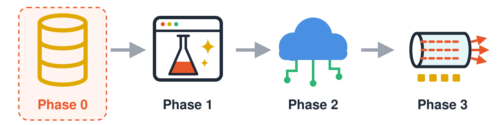

- **Phase 0:** Vector Database to Command Line Search
- **Phase 1:** Local Web App with Generative Text
- **Phase 2:** Deployed Equivalent of Phase 1
- **Phase 3:** Pipeline enabled, production AI App

<!--
Every later phase is built on the search from Phase 0. If retrieval is bad,
a nicer UI, Gemini, or the cloud won't fix it. That's why we start here.
-->

---

## Details of Phase 0

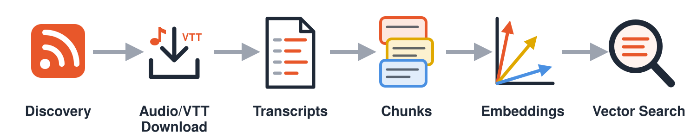

- **Discovery:** read the podcast's RSS feed: every episode, its mp3, maybe a transcript
- **(Audio Download):** only if the feed has no transcript
- **Transcripts:** text with timestamps, from the feed or from Whisper
- **Chunks:** about a minute of conversation each
- **Embeddings:** each chunk becomes a vector of numbers
- **Vector Search:** your question becomes a vector too; find the nearest chunks

<!--
Audio Download is in parentheses (and drawn dashed) because it's optional:
Tech Won't Save Us publishes transcripts, so we never downloaded its audio.
The rest of this deck walks through these boxes from left to right.
-->

---

## The goal

```
$ python search.py "energy and water use of data centers"
```

| | Similarity | Podcast | Episode | Time ▶ |
|---|---|---|---|---|
| 1 | 0.694 | Tech Won't Save Us | Canada's Government is Rushing AI Adoption | [40:49](https://pscrb.fm/rss/p/www.buzzsprout.com/1004689/episodes/19345841-canada-s-government-is-rushing-ai-adoption-w-hadrian-mertins-kirkwood.mp3#t=2449) |
| 2 | 0.688 | Tech Won't Save Us | Time for a Butlerian Jihad?: A 'Dune' Chat | [1:21:39](https://pscrb.fm/rss/p/www.buzzsprout.com/1004689/episodes/19218316-time-for-a-butlerian-jihad-a-dune-chat-w-ed-ongweso-jr-brian-merchant.mp3#t=4899) |
| 3 | 0.668 | Tech Won't Save Us | Why Countries Must Fight For Digital Sovereignty | [16:38](https://pscrb.fm/rss/p/www.buzzsprout.com/1004689/episodes/19218226-why-countries-must-fight-for-digital-sovereignty-w-cecilia-rikap.mp3#t=998) |

The right episode **and the right minute**, from hundreds of hours of audio.
None of those titles mentions energy, water, or data centers.

<!--
All three are Tech Won't Save Us. #2 is a conversation about Dune that turns to
communities fighting Google data centers over water use.
Keyword search on titles or show notes would never find that minute.
The timestamps matter because the web app will jump the audio player to that moment.
LIVE DEMO: click a time. It opens the mp3 at that second: the mp3 URL plus "#t=2449"
(the W3C media fragment standard), which works for any podcast host.
The real CLI output also prints the passage text and that same link.
-->

---

## 1. Discovery

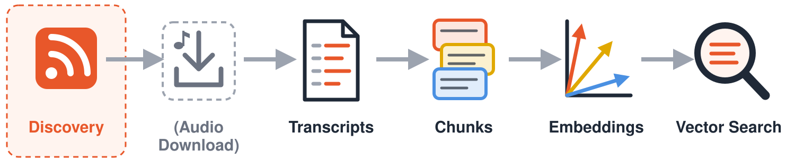

Every podcast publishes a free **RSS feed**: one XML file listing every episode and its mp3.
We turn each feed into a clean `episodes.json`.

| Tech Won't Save Us | Practical AI | Open Circuit | BibleProject | My Strange Bible |
|---|---|---|---|---|
| 371 (339 h) | 383 (297 h) | 95 (86 h) | 550 (513 h) | 127 (108 h) |

```
data/                                  (gitignored: never commit data)
  {podcast}/episodes.json              1. one dict per episode
```

<!--
Five podcasts, about 1,500 episodes and 1,340 hours of audio, from five small downloads.
We'll keep adding lines to this data layout as we go through the stages.
-->

---

## 2. (Audio Download): only when needed

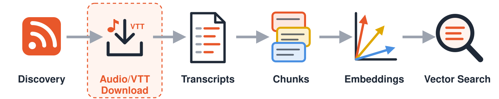

| Podcast | Feed has a transcript | Needs audio |
|---|---|---|
| Tech Won't Save Us | 370 | 1 |
| Practical AI | 77 (since 2025) | 306 (236 h, 15 GB) |
| Open Circuit, BibleProject, EMSB | 0 | all 772 |

```
data/
  {podcast}/episodes.json              1. one dict per episode
  {podcast}/raw_transcripts/{slug}.*   2. feed transcripts as published (.vtt, .json)
  {podcast}/audio/{slug}.mp3           2. only if the feed has no transcript
```

<!--
Audio is about 60 MB per hour, so 30+ GB for our podcasts. That's why data/ is gitignored.
BibleProject and EMSB: we reused Whisper transcripts made for an earlier project,
so only the ~120 newer episodes needed audio downloads.
-->

---

## 3. Transcripts: the slow step

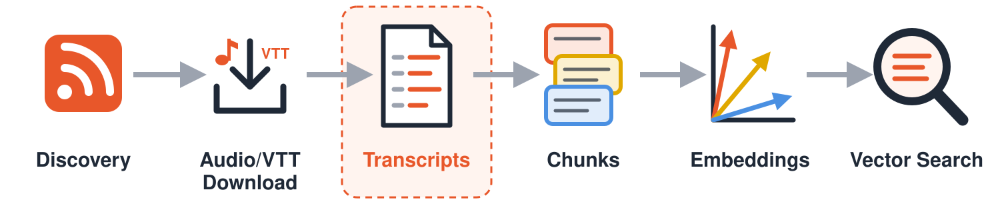

- **Feed transcript?** Convert it: seconds per episode
- **Only audio?** Run **Whisper**, OpenAI's open speech-to-text model, on your own machine
  - `faster-whisper` with `large-v3-turbo`: about **17× realtime** on a laptop GPU
  - 430 hours of audio ≈ **26 hours** of computing. Start early; run it overnight.

```
  {podcast}/transcripts/{slug}.json    3. {slug, source, text, segments}
```

<!--
Benchmarks on an M4 Pro MacBook: small.en on CPU 5x realtime, large-v3-turbo on CPU 6x,
large-v3-turbo on the Apple GPU 17x. A 45-minute episode takes under 3 minutes.
Everything after this step takes minutes, which is why it's its own stage.
-->

---

## 4. Chunks

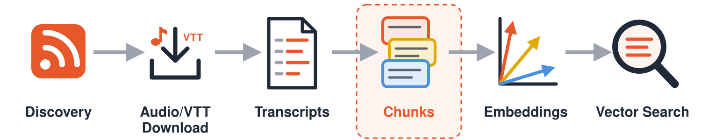

Cut each transcript into short pieces, so search can find **the moment**, not just the episode.

| | 500 characters | 1000 characters |
|---|---|---|
| Audio per chunk | ~25 seconds | ~55 seconds |
| Chunks (3 tech podcasts) | 86,668 | 38,762 |
| Best for | specific questions | broad topics, reading in context |

```
  {podcast}/chunks/{size}/{slug}.json  4. {id, text, start, end, ...}
```

<!--
We'll come back to 500 vs 1000 with real search results later in the deck.
-->

---

## 5. Embeddings

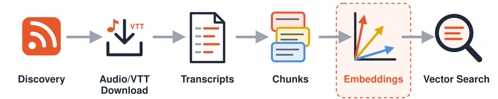

- An embedding model turns each chunk into a **vector**: 384 numbers that capture its meaning
- Model: `all-MiniLM-L6-v2`, small and free, runs on your laptop's CPU
- **ChromaDB** stores each vector with its text and metadata (podcast, title, start time)
- About 70,000 chunks embedded in **10 minutes**

```
data/chromadb/chunks_{size}/           5. one ChromaDB per chunk size, all podcasts
```

<!--
ChromaDB ships with all-MiniLM-L6-v2 built in (ONNX, so no PyTorch install).
In phase 2 we'll switch to Vertex AI embeddings in Google Cloud.
-->

---

## 6. Vector Search

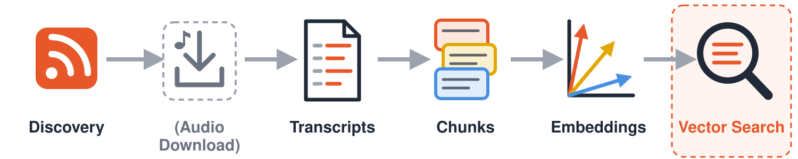

1. Embed the **question** with the same model
2. Find the chunk vectors pointing in the most similar direction: **cosine similarity**

| "data centers use a lot of water" vs. | cosine similarity |
|---|---|
| "cooling servers drains local rivers" | **0.46** (related meaning, no shared words) |
| "how to fine-tune a language model" | **0.00** (unrelated) |

1.0 = same direction, 0 = unrelated. Chroma reports distance: **similarity = 1 − distance**.

<!--
Cosine similarity is the cosine of the angle between two vectors. It ignores length and
only compares direction, which is what an embedding's "meaning" is.
-->

---

## Design requirement: build it in stages you can rerun

A **mindset** we'll follow all quarter, not just in Phase 0.

- Each stage is its own script: `python -m phase_0_command_line_search.s4_chunk`
- Reads the previous stage's folder, writes its own
- **Skips work that's already done**, so a crash halfway costs nothing
- `--limit 10`: try it on 10 episodes first · `--force`: redo it anyway

When something looks wrong, open the JSON in the folder between stages.

<!--
Transcription takes a day; indexing takes minutes. You don't want a bug in stage 5
to make you rerun stage 3.
Real example: Whisper ran for a day in the background while stages 4 and 5 were run
on the transcripts finished so far. Rerunning them later only processes the new episodes.
Ask Claude Code for this structure up front.
-->

---

<!-- _class: lead -->

## Now we transition from


<!--
Everything so far was the map. From here on, we open each stage's script.
This is also a natural place to stop lecturing and start building.
-->

---

## The files: shared settings

| Filename | Description | Output |
|---|---|---|
| `config.py` | Holds global configuration data | No output. Holds JSON-like data, but in a `.py` file |

<!--
The podcast list (key, title, RSS feed), chunk sizes, the Whisper model, and helper
functions that build every path in the data layout. Every other file imports it.
config.py and search.py sit at the top of the project, because the Phase 1 Flask app imports them too.
-->

---

## The files: getting transcripts

| Filename | Description | Output |
|---|---|---|
| `s1_discover.py` | Collects podcast and episode details | `episodes.json` |
| `s2_download.py` | Downloads the feed's transcript, or the audio if there isn't one | `raw_transcripts/{slug}.vtt` or `audio/{slug}.mp3` |
| `s3_transcribe.py` | Converts audio (or a feed VTT) to timed text | `transcripts/{slug}.json` |

All in `data/{podcast}/`.

<!--
These three are in phase_0_command_line_search/. s3 is the slow one (Whisper).
-->

---

## The files: making it searchable

| Filename | Description | Output |
|---|---|---|
| `s4_chunk.py` | Groups transcript segments into chunks | `data/{podcast}/chunks/{size}/{slug}.json` |
| `s5_index.py` | Embeds the chunks and stores them in ChromaDB | `data/chromadb/chunks_{size}/` |
| `search.py` | Searches ChromaDB from the command line | Results in the terminal |

<!--
s4 and s5 are in phase_0_command_line_search/. search.py is at the top, shared with Phase 1.
-->

---

## Part 1: Getting the data

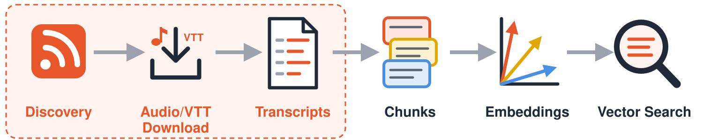

<!--
s1_discover, s2_download, s3_transcribe: from an RSS feed to timed transcripts.
-->

---

## s1_discover

`python -m phase_0_command_line_search.s1_discover` → `data/{podcast}/episodes.json`

1. Download each podcast's RSS feed (`requests`)
2. Parse the XML (`xml.etree.ElementTree`); one `<item>` per episode
3. Keep what later stages need:

```json
{"podcast": "tech-wont-save-us",
 "slug": "canada-s-government-is-rushing-ai-adoption-w-hadrian-mertins-kirkwood",
 "title": "Canada’s Government is Rushing AI Adoption w/ Hadrian Mertins-Kirkwood",
 "published": "2026-06-18T03:00:00-04:00",  "duration_s": 3665,
 "audio_url": "https://pscrb.fm/rss/p/www.buzzsprout.com/.../19345841-....mp3",
 "transcripts": [{"url": "https://www.buzzsprout.com/1004689/19345841/transcript.vtt",
                  "type": "text/vtt"}, ...]}
```

<!--
The slug is made from the title (lowercase, hyphens) and names every file for this episode
in every later stage. transcripts comes from the Podcasting 2.0 tag <podcast:transcript>.
This stage is cheap (one download per podcast), so it always rewrites episodes.json.
To find a podcast's feed URL, search Apple's iTunes Search API by name.
-->

---

## Two ways to get a transcript

**The feed publishes one.** Tech Won't Save Us links a VTT file for 370 of 371 episodes:

```
00:00:07.040 --> 00:00:13.519
<v SPEAKER_02>But it's part of this narrative of AIs are separate autonomous ...
```

**Or run Whisper yourself.** Practical AI before 2025, and Open Circuit:
`faster-whisper` with `large-v3-turbo` ran about **17× realtime** on a laptop GPU, so a 45-minute episode takes under 3 minutes.

Check your podcast's RSS feed for `<podcast:transcript>` before you transcribe anything.

<!--
Buzzsprout and Transistor hosts publish transcripts; Megaphone and Simplecast feeds didn't.
Whisper at 17x realtime is still about a day for 400 hours of audio. Start it early and let it run overnight.
On a CPU, smaller models (small.en) are a better fit.
-->

---

## s2_download

`python -m phase_0_command_line_search.s2_download`: for each episode in `episodes.json`:

| If... | Then |
|---|---|
| `transcripts/{slug}.json` already exists | skip it |
| the feed links a timed transcript (VTT or JSON) | save it, as published, to `raw_transcripts/` |
| otherwise | download the mp3 to `audio/` |

- Downloads stream to `{slug}.mp3.part`, renamed only when complete
- So a crash or Ctrl-C never leaves a half file that looks finished

<!--
Raw transcripts are kept unchanged so stage 3 can re-convert them later (for example,
with better speaker handling) without downloading again.
Flags: --audio-only, --transcripts-only, --limit, --force, --podcast.
-->

---

## s3_transcribe

`python -m phase_0_command_line_search.s3_transcribe` → `transcripts/{slug}.json`

**From a feed VTT** (seconds): parse the cues, keep the `<v Speaker>` names, split long cues into sentences (≤ 300 characters)

**From an mp3** (minutes): `faster-whisper`

```python
model = WhisperModel("large-v3-turbo", device="mps", compute_type="float16")
segments, info = model.transcribe("episode.mp3", language="en",
                                  vad_filter=True,                   # skip silence and music
                                  condition_on_previous_text=False)  # avoid repeated-line loops
```

Ctrl-C finishes the current episode, then stops. Rerun to continue.

<!--
device="mps" is the Apple silicon GPU; on other machines use "auto" (CUDA if available, else CPU).
For the long run: nohup caffeinate -i python -u -m phase_0_command_line_search.s3_transcribe --whisper-only > data/logs/s3_whisper_log.txt &
Whisper doesn't identify speakers, so speaker is null for those transcripts.
-->

---

## What a transcript looks like

Both paths produce the same shape: text **and timed segments**.

```json
{
  "slug": "2025-was-the-year-of-agents-what-s-coming-in-2026",
  "source": "feed_vtt",
  "segments": [
    {"start": 149.74, "end": 161.03, "speaker": "Daniel", "text": "I'm already a year ahead, I guess. ..."},
    {"start": 161.04, "end": 161.84, "speaker": "Chris",  "text": "I'm okay with that."}
  ]
}
```

About **450 segments** per episode, about **100 characters** each.
Keep the timestamps. Every later stage depends on them.

<!--
Practical AI's feed names its speakers (Daniel, Chris, and "Sponsor" for ad reads).
Tech Won't Save Us uses SPEAKER_00, SPEAKER_01. Whisper gives no speakers at all (speaker: null).
If your podcast publishes transcripts without timestamps, you can still search,
but you can't jump the player to the right moment. That's a real tradeoff for your team.
-->

---

## Part 2: Vectorizing the data

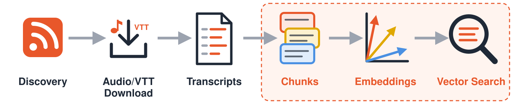

<!--
s4_chunk, s5_index, search.py: from transcripts to a searchable vector database.
-->

---

## Why not embed a whole episode?

An embedding turns a piece of text into **one vector**.

- One vector for a 60-minute episode averages **every topic in it** together
- Search could find the episode, but not the moment
- And models have a limit: `all-MiniLM-L6-v2` reads only **256 tokens** (about 1,000 characters), and ignores the rest

So we split each transcript into **chunks** and embed each one.

<!--
Two reasons to chunk: the model's input limit, and focus.
Students usually only think of the first one. The second one matters more (see the 500 vs 1000 slides).
-->

---

## Chunking: group whole segments

Add segments until the next one would push the chunk past the size limit:

```
segments:  [s0][s1][s2][s3][s4][s5][s6][s7][s8][s9] ...
chunk 0:   [s0 ................ s5]
chunk 1:                    [s4 ............... s9]
                             ↑ overlap
```

- A chunk never cuts a segment in half
- So `start` = first segment's start, `end` = last segment's end, **exactly**

<!--
The older approach: split text by characters with a library splitter, then try to find
which segments each chunk came from by substring matching. That guesses wrong on short
repeated lines like "Yeah." and cuts segments at boundaries. Grouping whole segments avoids
the guessing entirely, and it's about 20 lines of Python.
-->

---

## Why overlap?

A thought often crosses a chunk boundary.

Overlap repeats the last few segments at the start of the next chunk, so the thought appears **whole** in at least one chunk.

- 1000-character chunks: 150 characters of overlap (15%)
- 500-character chunks: 100 characters (20%), about 1 segment

(These shows' segments average about 100 characters.)

Shorter chunks get cut mid-thought more often, so they get a bit more overlap.

---

## s4_chunk

`python -m phase_0_command_line_search.s4_chunk --size 1000` → `chunks/1000/{slug}.json`

```python
def chunk_segments(segments, size, overlap):
    """Return (first, last) segment index pairs."""
    # add whole segments until the next one would pass `size` characters,
    # then back up about `overlap` characters of whole segments and repeat
```

- About 30 lines of plain Python, no libraries
- Runs in **seconds** for every podcast
- `--size 500` for the small chunks; overlap defaults to 100 for 500 and 150 for 1000

<!--
chunk_transcript() turns each (first, last) pair into a chunk dict: text joined from the
segments, start from the first segment, end from the last.
Because it's so fast, try several sizes and compare them with real searches.
-->

---

## One chunk

```json
{
  "id": "tech-wont-save-us/chatgpt-is-not-intelligent-w-emily-m-bender/037",
  "podcast": "tech-wont-save-us",
  "slug": "chatgpt-is-not-intelligent-w-emily-m-bender",
  "text": "And so then when we're looking at these kind of chatbots and ...",
  "start": 1704.72,
  "end": 1745.36,
  "segment_first": 294,
  "segment_last": 297
}
```

- `id` is stable: rebuilding gives the same IDs
- `segment_first`/`last` let you widen the context later

<!--
Stable IDs matter: the indexer checks "is this ID already in the database?" to skip finished episodes.
The podcast name is in the ID because two shows could have an episode with the same slug.
-->

---

## s5_index

`python -m phase_0_command_line_search.s5_index --size 1000` → `data/chromadb/chunks_1000/`

For each episode's chunks file:

1. **Skip** it if its first chunk ID is already in the collection
2. Look up the episode in `episodes.json` (title, date, `audio_url`)
3. `collection.add(...)`: Chroma embeds the text and stores the vector, text, and metadata

About **10 minutes** for 70,000 chunks on a laptop CPU. `--force` deletes the collection and rebuilds it.

<!--
The first run downloads the embedding model (~80 MB) to ~/.cache/chroma.
Each chunk size gets its own folder, so data/chromadb/chunks_500/ and chunks_1000/ sit side by side.
-->

---

## Embeddings in one slide

An embedding model maps text to a point in space (384 numbers for MiniLM).
Texts that **mean** similar things land close together:

| | data centers use a lot of water |
|---|---|
| cooling servers drains local rivers | **0.46** |
| how to fine-tune a language model | **0.00** |

**Cosine similarity** measures closeness: 1.0 = same direction, 0 = unrelated.
Search = embed the question, then find the nearest chunk vectors.

<!--
The first pair shares no important words, but the meaning overlaps, so it scores well.
For phase 1 we use ChromaDB's built-in model (all-MiniLM-L6-v2). It runs on ONNX,
so you don't need to install PyTorch. In phase 2 we switch to Vertex AI embeddings,
which removes the model from your server entirely.
-->

---

## ChromaDB: adding chunks

```python
import chromadb

client = chromadb.PersistentClient(path="data/chromadb/chunks_1000")
collection = client.get_or_create_collection(
    "chunks_1000", configuration={"hnsw": {"space": "cosine"}})

collection.add(
    ids=[c["id"] for c in chunks],
    documents=[c["text"] for c in chunks],      # Chroma embeds these
    metadatas=[{"podcast": c["podcast"], "slug": c["slug"],
                "start": c["start"], "end": c["end"],
                "title": ep["title"], "audio_url": ep["audio_url"]}
               for c in chunks],
)
```

<!--
No LangChain. The plain client is short enough to read in one screen.
"documents" is what gets embedded. "metadatas" comes back with search results.
One collection holds every podcast; the podcast field tells them apart.
-->

---

## Copy episode data onto every chunk

Each chunk's metadata includes the episode's `title`, `podcast`, `published`, `audio_url`.

- That's repeated about 60 times per episode
- But a search result can be **shown immediately**, without looking anything else up
- Metadata also lets you **filter**: `where={"podcast": "practical-ai"}`

Chroma metadata values must be simple: strings, numbers, booleans. No lists or dicts.

---

## search.py

`python search.py "energy and water use of data centers"`

| Option | Meaning |
|---|---|
| `-k 5` | how many results |
| `--podcast practical-ai` | search one podcast |
| `--slug ...` | search inside one episode |
| `--size 500` | which chunk-size collection |
| `--no-distinct` | allow several chunks from the same episode |
| (no query) | interactive: keep asking questions |

The `search()` function returns plain dicts (text, similarity, title, start, `play_url`, ...), so the Flask app can reuse it.

<!--
play_url is the mp3 URL plus #t=SECONDS, so a result can be played at the right moment.
-->

---

## ChromaDB: searching

```python
res = collection.query(query_texts=["energy and water use of data centers"],
                       n_results=5)

for doc, meta, dist in zip(res["documents"][0],
                           res["metadatas"][0], res["distances"][0]):
    print(round(1 - dist, 3), meta["title"], meta["start"])
```

Chroma returns **distance** (smaller = closer).
For cosine: **similarity = 1 − distance**. Show users similarity.

<!--
The results come back as lists of lists, one list per query, which is why there's a [0] everywhere.
Students mix up distance and similarity constantly. Pick one and label it.
-->

---

## Problem: one episode fills the results

> why do chatbots make things up

```
--no-distinct                                  default (distinct)
[1] 0.731 ChatGPT Is Not Intelligent           [1] 0.731 ChatGPT Is Not Intelligent
[2] 0.704 Chatbots Are Repeating Social...     [2] 0.704 Chatbots Are Repeating Social...
[3] 0.697 Chatbots Are Repeating Social...     [3] 0.634 The AI community building...
[4] 0.688 Chatbots Are Repeating Social...     [4] 0.633 Digital humans & detecting...
[5] 0.680 Chatbots Are Repeating Social...     [5] 0.629 How is AI shaping democracy?
```

Chroma can't group by episode, so **ask for 10× more results and keep the best chunk per episode**.

<!--
A small post-processing step that makes results much more useful.
For a boolean command-line flag, use argparse.BooleanOptionalAction:
it creates both --distinct and --no-distinct. Avoid type=bool: bool("false") is True.
-->

---

## When search misses

> how much water does AI use

```
[1] 0.513  Stanford's AI Index Report 2024
[2] 0.478  Building Durable AI Agents
[3] 0.463  Build a workspace of AI agents
```

In two AI podcasts, **"AI" is in almost every chunk**, so it doesn't help pick one.
Asking *"how much water do data centers use"* finds the data center episodes again.

Small embedding models lean hard on a few words. Try several phrasings, and write down the misses.

<!--
The embedding of "how much water does AI use" is almost as close to the single word "AI" (0.46)
as to "data centers use a lot of water" (0.52), so thousands of AI chunks compete with the right ones.
Ways to fix this later: a bigger embedding model (Vertex AI in phase 2), hybrid keyword + vector search,
or letting Gemini rewrite the question before searching.
Your list of misses becomes your evaluation set in Project 2.
-->

---

## Chunk size: 500 vs 1000 characters

Same transcripts, two collections. A **specific** question:

> what is quantization

| 500 characters | 1000 characters |
|---|---|
| 0.728 Federated learning in production (20:05) | 0.661 Large models on CPUs (18:08) |
| 0.672 Large models on CPUs (18:33) | 0.538 Rise of the AI PC & local LLMs (27:38) |
| 0.651 Rise of the AI PC & local LLMs (28:40) | 0.420 Stellar inference speed via AutoNAS (13:47) |

The small chunk that **defines** the word wins. At 1000 characters, that definition is diluted by everything around it.

<!--
The 500-character winner is a 28-second chunk from an episode about federated learning
that happens to define the word: "Quantization being methods to limit the precision or the size
of the total parameter set..." In a 1000-character chunk, that one sentence is averaged
together with a minute of other conversation, and it doesn't make the top 3.
-->

---

## Chunk size: a broad question

> energy and water use of data centers

| 500 characters | 1000 characters |
|---|---|
| 0.758 Too Much Computer: Hyperscale (40:57) | 0.694 Canada's Government is Rushing AI… (40:49) |
| 0.755 Brazil's Battle to Rein In Big Tech (48:55) | 0.688 Time for a Butlerian Jihad? (1:21:39) |
| 0.703 Brazil's Data Center Boom… (44:54) | 0.668 Why Countries Must Fight… (16:38) |

Different episodes, but **all six are on topic**. For a broad topic, either size works.

**Don't compare scores across collections.** Compare whether the results are right.

---

## The tradeoffs

| | 500 characters (~25 s) | 1000 characters (~55 s) |
|---|---|---|
| Specific questions | sharper | blurred |
| Reads well on its own | often starts mid-thought | a full exchange |
| Jumps the player to | close to the moment | up to a minute early |
| Chunks (3 tech podcasts) | 86,668 | 38,762 |

A common pattern: **search with small chunks, show a bigger window** around the hit.

<!--
The segment_first / segment_last fields make the "bigger window" easy: grab a few
segments on either side of the hit. That's also what you'll send to Gemini in the RAG step.
-->

---

## Your team's assignment

1. Pick **2 to n podcasts**
2. Get **text with timestamps** for **200+ episodes** (some via feed transcripts, some via Whisper)
3. Write the chunker; open the output and read a few chunks. Pick **2 (or more)** chunk sizes.
4. Load them into ChromaDB
5. Build a **command-line search**

Then: try your chunk sizes on **5 questions you write yourselves**. Which wins, and why?

<!--
Step 5 is deliberate: a CLI search lets you judge retrieval quality without UI bugs in the way.
The 5 questions are the first taste of evaluation; Project 2 does it properly.
-->

---

## The plan: we're doing Phase 1 next

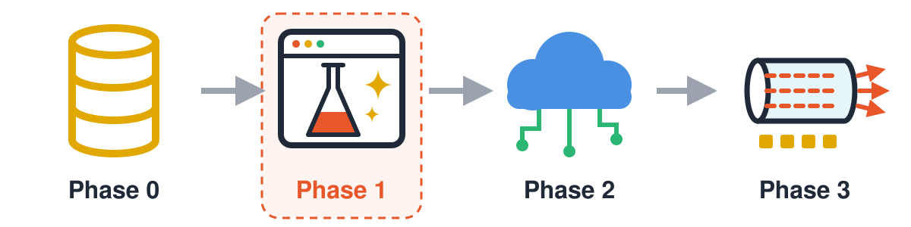

Next: put this behind a Flask API with a podcast player.
