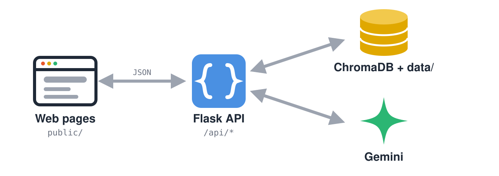
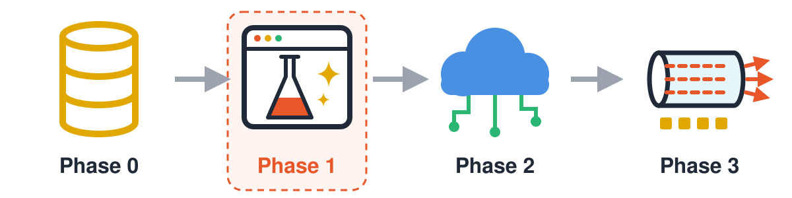
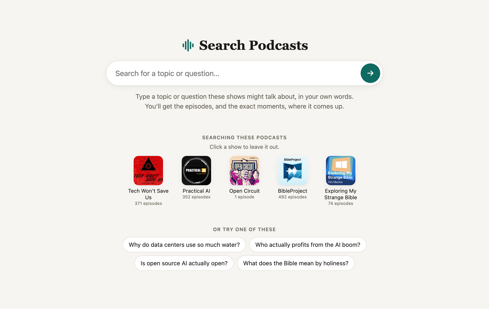
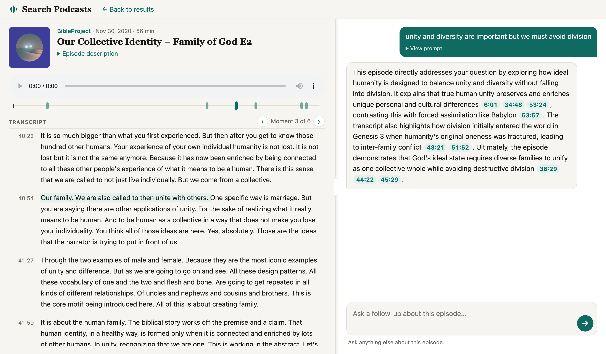
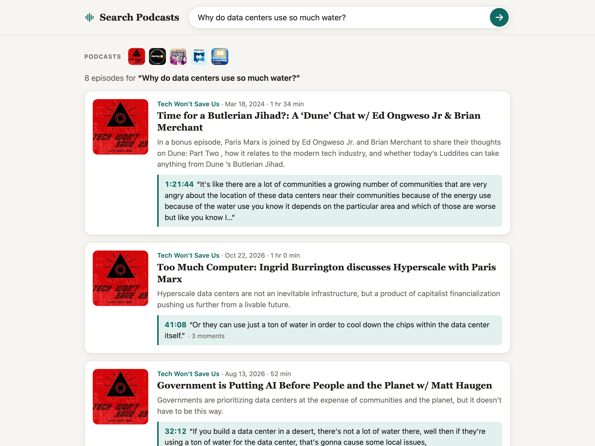
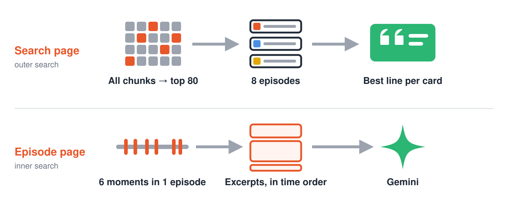
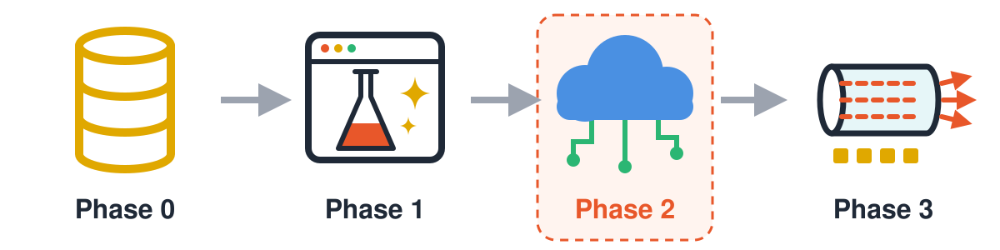

<!-- _class: lead -->

# Phase 1: Local Web App with Generative Text
### Search Page → Episode Page → Moments → Prompt → Chat



CSSE 417 · Project 1: Podcast Agent

<!--
Same five podcasts as Phase 0, about 1,500 episodes. Everything on these slides comes
from the working solution, in the order we built it, so the numbers and screenshots are real.
-->

---

## The plan: we're doing Phase 1



- **Phase 0:** Vector Database to Command Line Search
- **Phase 1:** Local Web App with Generative Text
- **Phase 2:** Deployed Equivalent of Phase 1
- **Phase 3:** Pipeline enabled, production AI App

<!--
Phase 1 reuses search() from Phase 0 unchanged at its core. Everything new is
the web app around it and one new ingredient: a language model.
-->

---

## The goal: two pages

 

- **Search page:** type a topic or question, get episodes **and the moment** it comes up
- **Episode page:** player + transcript on the left, an AI conversation on the right

<!--
LIVE DEMO: search "Why do data centers use so much water?", click a card,
watch the player and transcript jump to the moment, read the AI summary, ask a follow-up.
-->

---

## Design first: what goes where

| | Search page | Episode page |
|---|---|---|
| Shows | show, title, date, short description, **one matching line** | player, full transcript, moments |
| Generative AI | **none** | summary + follow-up chat |
| Links out | none: the whole card opens the episode page | none |

**Why no AI on the search page?** 8 cards = 8 model calls per search:
slower results, free-tier rate limits, and most summaries would never be read.
Generate text **when the user asks for it**: when they open an episode.

<!--
We argued this out before writing code. The tempting design is a summary on every card.
Cost isn't really the problem (Flash models are cheap); delay and rate limits are.
Rule of thumb for the course: put the model call behind a user action.
-->

---

## Which model?

| Option | Works for an app? |
|---|---|
| Your **Claude Pro** plan | **No.** It covers Claude Code, not API calls from your own app |
| Claude API key | Yes, but pay-as-you-go, separate from Pro |
| **Gemini through Google AI Studio** | **Yes. Free tier**, and the same SDK runs on Google Cloud in Phase 2 |

```
# project1_podcast_agent/.env   (gitignored, never committed)
GEMINI_API_KEY=...
```

The app loads `.env` itself (`python-dotenv`), so nothing is exported in your shell.

<!--
Anthropic's terms: apps can't run on a claude.ai login. Use an API key.
Free-tier Gemini prompts may be used by Google to improve its models: fine for public
podcast transcripts, but don't type anything private into your app.
-->

---

## Architecture: static pages + a JSON API


- `public/`: plain HTML, CSS and JavaScript. **No server-side templates.**
- Flask only answers `/api/*` with JSON
- Phase 2: `public/` goes to **Firebase Hosting**, `/api/*` goes to **Cloud Run**, nothing else changes

<!--
Templates (Jinja) would be simpler for one more week and harder forever after:
Firebase Hosting serves static files only. Building it this way now makes Phase 2 a move, not a rewrite.
-->

---

## The API

| Route | Returns |
|---|---|
| `GET /api/podcasts` | the shows being searched |
| `GET /api/search?q=...&skip=...` | 8 episode cards |
| `GET /api/episode/<podcast>/<slug>` | episode details + every transcript line |
| `GET /api/moments/<podcast>/<slug>?q=...` | where the question comes up in this episode |
| `POST /api/summary` | the AI summary (cached) |
| `POST /api/chat` | a follow-up answer |

```
cd phase_1_local_flask_app && python app.py        # http://localhost:8080
```

<!--
app.py: import flask, handle_* route names, static_folder="public", "/" redirects to /index.html.
Run it with the VS Code Play button too: set python.defaultInterpreterPath to the project's .venv.
Bind to 127.0.0.1, not 0.0.0.0: anyone who can reach the server can spend your Gemini quota.
-->

---

## The search page



<!--
Each card: show art, show · date · length, title, the first ~250 characters of the description
cut at a sentence end, and the one line that matched, with its timestamp and "N moments".
-->

---

## Anatomy of a card

| Part | Where it comes from |
|---|---|
| Art | the episode's image, else the show's cover (`show.json`, new in stage 1) |
| Description | first ~250 characters of the show notes, **cut at a sentence end** |
| `1:21:44 “It's like there are a lot of communities…”` | the **best line** inside the winning chunk |
| `· 3 moments` | how many of the top 80 chunks came from this episode |

No model call anywhere on this page. Search takes about **half a second**.

<!--
Show notes start with a summary and end with links and sponsors, so the start is the useful part.
Episode art is sparse in RSS feeds (Open Circuit: none), so stage 1 now saves the show's cover too.
-->

---

## Finding the best line: retrieve coarse, re-rank fine

A chunk is ~1,000 characters: a minute of talk. Too long for a card, too vague for a timestamp.

1. ChromaDB finds the winning **chunk** (out of 74,552)
2. Embed **each transcript line** in that chunk, with the same model, in memory
3. The line closest to the query wins; its `start` is the timestamp

```python
vectors = embed([query] + [line["text"] for line in lines])  # ~100 short texts, one batch
scores = vectors[1:] @ vectors[0]                             # cosine (vectors are normalized)
```

**The lines are not in ChromaDB.** That would be 889,114 records, and one line alone
("Yeah, exactly.") retrieves badly.

<!--
Two steps is a standard RAG pattern: a vector DB for the big search, plain math for the small re-rank.
We borrow Chroma's own embedding function (all-MiniLM-L6-v2, ONNX) so the scores are comparable.
-->

---

## Whisper splits sentences

```
"...and we're hosted"   |   "on Linode."
"when it comes to AI development."
```

Grow the chosen line to **whole sentences**: add the line before while it doesn't start a
sentence, the line after while it doesn't end one (max ~300 characters).

Bonus: the timestamp moves back to **where the sentence starts**.

If it still starts or ends mid-sentence, the page adds "…".

<!--
Small detail, big difference in how professional the cards feel.
-->

---

## Cleanup you only find by looking

- **Rebroadcasts:** "Data Vampires **Redux**: …", "… **[Replay]**" showed up twice.
  Drop a result whose title matches once those words are removed, or whose best line is identical.
- **Episode art:** BibleProject's feed has art for 136 of 551 episodes.
  The publisher's site metadata has series art: **487 of 551**.
- **Image size:** 700 KB per image → **11 KB** by asking the image host for 240 px (`?tr=w-240`)
- **"1 episodes"** → `plural(n, "episode")`

Run real searches. Read the results. Fix what looks wrong.

<!--
None of these came from planning; all of them came from using the app.
The BibleProject art is instructor-only data from an earlier project; your podcasts may have
their own sources (or not).
-->

---

## Leave a podcast out


Click a cover to leave that show out. Where should the filter run?

- **After** the search, by hiding cards: 8 results become 5
- **Inside** the vector search: `where={"podcast": {"$in": [...]}}` → **still 8**

<!--
Same idea as the distinct-episodes trick in Phase 0: do the filtering where the ranking happens.
-->

---

## The URL is the state

```
/index.html?q=Why+do+data+centers+use+so+much+water%3F&skip=bibleproject
/episode.html?podcast=bibleproject&slug=...&q=...&t=2455&e=2458
```

- **Back**, **Reload** and **shared links** all work, with no server-side sessions
- `t` and `e`: the moment you clicked, so the episode page can start there

<!--
history.pushState for a new search, history.replaceState for a filter change
(a filter change shouldn't be a new Back step). Your choice of left-out podcasts
is also remembered in localStorage for your next visit.
-->

---

## The episode page


<!--
Left: art, title, description, the browser's own audio player, the moments strip, the transcript.
Right: the conversation. The bar between them drags to resize.
-->

---

## Player + transcript

- `<audio src="...mp3#t=2455">`: the browser's built-in player, starting at the moment
- Transcript lines are `<span>`s: **click a line to play from there**
- While playing: highlight the current line and scroll along (binary search on `start`)
- Stop scrolling along for a few seconds when the reader scrolls

The audio streams **from the podcast's own host**. We never serve an mp3.

<!--
Setting audio.currentTime only works after "loadedmetadata"; the #t= fragment covers the rest.
This is the same pattern as the Genesis Melodies site.
-->

---

## Two searches



The episode page **searches again**, only inside this episode (`where={"slug": ...}`).

<!--
The outer search picks episodes. The inner search picks moments. They can disagree on the count
("3 moments" on the card, 6 on the page), and that's fine: they answer different questions.
-->

---

## Moments: where the question comes up


- The inner search's 6 best chunks → **ticks** under the player, **highlighted** lines in the transcript
- `‹ Moment 3 of 6 ›` steps through them
- No AI: just the vector search, drawn on a timeline

<!--
The same 6 moments are what Gemini reads (next slides), so the ticks and the AI's citations agree.
-->

---

## RAG: what Gemini reads

For each moment: the chunk **plus one neighbor on each side**, merged where they touch, **in time order**.

```
[35:22] In fact it is going to be precisely through innumerable cycles of dividing and being
        reunited as one that humanity images God. ...
[35:55] Humans image God when I see my humanity only as it participates in others around me ...
[...]
[53:49] The unity where one culture assimilates everything into itself to make it its own
        version of one? This is called Babylon. ...
```
*(Our Collective Identity – Family of God E2, for "unity and diversity are important but we must avoid division")*

- Built from **transcript lines**, not pasted chunks: chunks overlap by 150 characters
- A `[mm:ss]` mark at each speaker change and at least every 30 s
- About **15,000 characters (~3,800 tokens)** for one summary

<!--
In order matters: the model can follow the conversation and the argument.
Neighbors matter: a hit often starts mid-thought.
Why not the whole transcript? ~15k tokens per hour of audio, 3-4× more, and it's
Project 2's long-context topic.
-->

---

## The prompt is a file

`prompts/system.txt`
```
You help people explore podcast episodes. ...
Rules:
- Answer only from the episode material below. If it doesn't address the question, say so plainly.
- Cite the moments you rely on with their timestamps exactly as written, e.g. [12:34].
- You may use **bold**, *italics* and short bullet lists when they help. No headings, tables or links.

Podcast: {podcast}
Episode: {episode_title} ({published})
Description: {description}
Nearby episodes of this podcast, oldest first (titles only):
{nearby_episodes}
Transcript excerpts (in time order; [...] marks skipped parts of the episode):
{excerpts}
```

`prompts/summary_request.txt`
```
My question: {question}
Why is this episode a good match for my question? In 3-4 sentences, explain how it answers it.
```

<!--
Prompt text lives in plain text files, not in Python and not in JSON (no \n escapes; git diffs
show exactly which words changed). The code only fills in the {placeholders}.
Nearby episodes: titles of the 3 episodes before and after by date. Series episodes come out
back to back, so the model sees the rest of the series without any series data.
-->

---

## A prompt is a data structure, not a string

```python
client.models.generate_content(
    model="gemini-3.5-flash",
    config=GenerateContentConfig(system_instruction=system),   # "System instruction"
    contents=[Content(role="user",  parts=[Part(text="My question: ...")]),
              Content(role="model", parts=[Part(text="<the summary>")]),
              Content(role="user",  parts=[Part(text="<a follow-up>")])])
```

| | System part | Conversation roles |
|---|---|---|
| Gemini | `system_instruction` | `user`, `model` |
| Claude | top-level `system` | `user`, `assistant` |
| OpenAI | a `system` (or `developer`) message | `user`, `assistant` |

"View full prompt" shows exactly this structure: one heading per field.

<!--
Every chat API has the same shape with different names. Underneath, the model still reads one
long sequence of tokens: the API converts the structure into the "chat template" the model was
trained on, with special markers where each role starts and stops.
The model remembers nothing between calls: the conversation IS this list, resent every time.
Project 2 preview: tool calls and tool results are just more entries in the same list.
-->

---

## Prompt engineering needs to be visible

- Edit a prompt file → **reload**: files are read on every request
- The summary cache key includes a **hash of the prompt files**: no stale answers
- **View full prompt** in every question bubble, **before** Gemini answers: the system instruction, every turn, ~tokens, then the model that answered

You can't improve a prompt you can't see.

<!--
DEMO: change "3-4 sentences" to "2 sentences", reload, open View full prompt.
Students should look at the excerpts the retrieval actually chose: most bad answers are
retrieval problems, not wording problems.
-->

---

## Citations become buttons

The model writes:
```
...people unify without erasing their differences [34:48] [35:55].
```

The page turns each `[mm:ss]` into a chip that **plays that moment**.

Only possible because every excerpt line carries its real timestamp, and the prompt says
*"cite exactly as written."*

<!--
Formatting: the prompt allows a small markdown subset (bold, italics, bullet and numbered lists).
The page renders only that subset, with its own ~60 lines of JavaScript that build DOM nodes from text,
never innerHTML: the model's output is untrusted input (transcripts + anyone's question), so a
"<script>" or a [link](...) in an answer stays plain text. Headings become a bold line.
Also: merge "[17:32], [18:06]" into one group of chips.
-->

---

## One call, a chat, or an agent?

| | What it is | Here? |
|---|---|---|
| **One call** | prompt in → text out | the summary |
| **Chat** | one call per turn, **resending the whole conversation**; the model remembers nothing | the follow-ups |
| **Agent** | the model runs in a loop and **chooses to call tools** (search, fetch, …) | **Project 2** |

The summary is the **first answer of the chat**: the conversation opens as if you asked
*"why this episode for my question?"*

<!--
Our follow-ups still retrieve: every turn, the code searches the episode for the new question.
The difference from an agent: our code always retrieves the same way; an agent decides when and what.
-->

---

## A chat that can't run up your bill

The browser sends only short questions and answers. The server rebuilds everything else.

| Cap (server-side) | Value |
|---|---|
| Question length | 500 characters |
| Earlier answers sent back | 1,500 characters each |
| Follow-ups per conversation | 6 |
| Output tokens per call | 2,048 |

Worst case: ~7 calls × ~5k tokens per conversation, **no matter what someone pastes**.

<!--
Never accept context from the browser: someone could paste 100k tokens into a fake history.
The summary (the first answer) is read from the server's cache, not from the browser.
Login and per-user cost caps are Project 2.
-->

---

## Gemini on the free tier: what we hit

| Problem | Fix |
|---|---|
| `gemini-2.5-flash`: 404, closed to new keys | list your models: `client.models.list()` |
| 503 "high demand" | try the next model in `GEMINI_MODELS` |
| A summary took 37–98 s | `thinking_level="minimal"`: **1.3 s**, same quality |
| 400 "Thinking level MINIMAL is not supported" | not every model accepts every setting: test each one |
| 429 rate limited | show "busy, try again in a minute", not an error page |

<!--
Model names and limits change month to month. Write the code so the model list is one line in config.py.
Thinking: summarizing excerpts you were handed doesn't need deep reasoning; measure before you pay for it.
-->

---

## What we decided not to do

- **AI on the search page:** too many calls nobody reads
- **The whole transcript in every prompt:** 3-4× the tokens; retrieval does the job
- **Series:** none of our feeds use RSS season tags. Nearby episode titles get most of the value.
- **Tools / agents:** Project 2

Saying no is part of the design.

---

## Your team's assignment

1. A **search page**: cards with a description and the **best line + timestamp**
2. An **episode page**: player that starts at the moment, transcript you can click
3. A **summary** from your own prompt file, with timestamps that play
4. **Follow-up chat** with server-side caps
5. A **View full prompt** link (or a log) showing exactly what was sent

Then: change one thing in your prompt, ask the same 5 questions as in Phase 0, and compare the answers.

<!--
Draft assignment: discuss scope with the team leads. Items 1-2 are pure web work on top of
Phase 0; 3-5 are the new AI parts.
-->

---

## The plan: we're doing Phase 2 next



Next: the same app on Google Cloud: Firebase Hosting for `public/`, Cloud Run for `/api/*`,
Vertex AI embeddings and Gemini.
