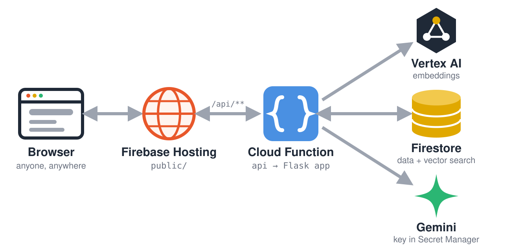
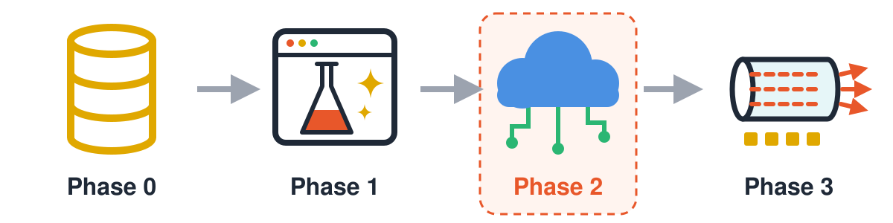
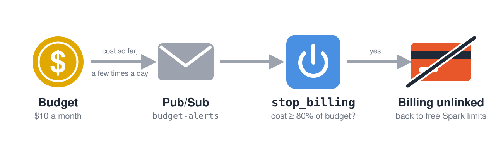
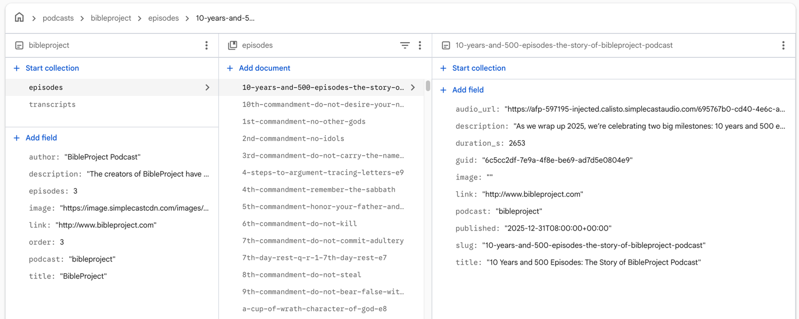
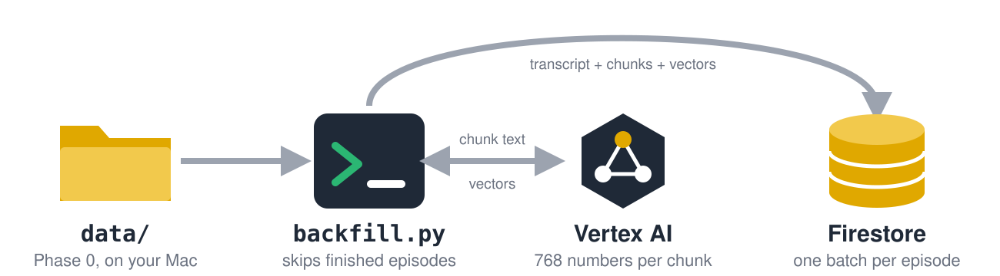
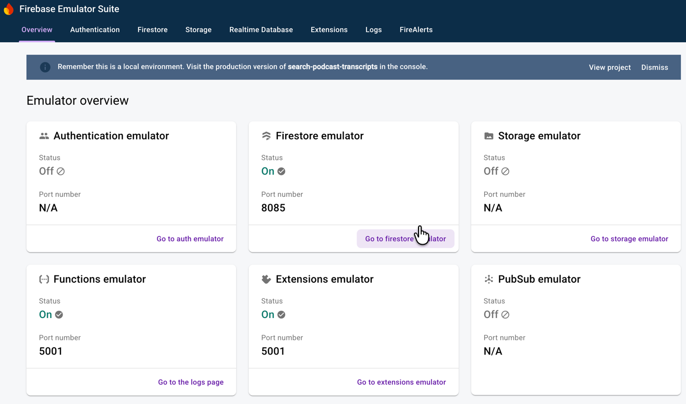
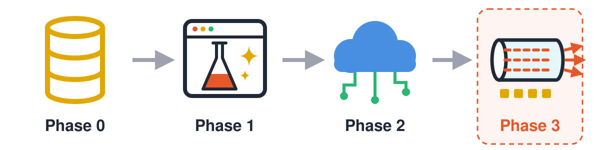

<!-- _class: lead -->

# Phase 2: The Same App on Google Cloud
### Firebase Hosting → Cloud Function → Firestore + Vertex AI



CSSE 417 · Project 1: Podcast Agent

<!--
Everything on these slides comes from building the solution: the commands, errors, numbers and
costs are real. Part A sets up the cloud project and makes it safe to spend money.
Part B moves the data and the search into the cloud.
-->

---

## The plan: we're doing Phase 2



- **Phase 0:** Vector Database to Command Line Search
- **Phase 1:** Local Web App with Generative Text
- **Phase 2:** Deployed Equivalent of Phase 1
- **Phase 3:** Pipeline enabled, production AI App

---

## The goal: the same app, on the internet

**No new features.** Every hard problem of running in the cloud instead:

| Phase 1 (your laptop) | Phase 2 (Google Cloud) |
|---|---|
| `public/` served by Flask | `public/` on **Firebase Hosting** (unchanged) |
| `python app.py` | **Cloud Function** running the same Flask routes |
| `data/` files: episodes, transcripts, chunks | **Firestore** documents |
| ChromaDB + MiniLM | Firestore **vector search** + **Vertex AI** embeddings |
| `GEMINI_API_KEY` in `.env` | **Secret Manager** |
| free | **real money**: so we start with cost safety |

End result: `https://search-podcast-transcripts.web.app`

---

## We COULD quickly get our Flask app online, but...

The quickest deploy, copying the 880 MB ChromaDB folder and the MiniLM model into a container,
would actually **cost us time**: none of it is useful for Phase 3, the final phase. A hack costs twice.

| | Quick hack | The eventual way |
|---|---|---|
| Vector store | Chroma files baked into the image | **Firestore** (a real database) |
| New episodes (Phase 3) | rebuild and redeploy the image | **upsert** a few documents |
| Embeddings | 90 MB model in every instance, slow cold starts | an **API call** |
| Later | undo all of it | keep building |

**Rule for this project:** if we'll need it eventually, build it that way now.
A hack is built once and then undone once.

<!--
Phase 2's product doesn't matter much on its own. It's a step toward Phase 3, where new
episodes flow in automatically. Every shortcut that only works for a frozen dataset would
have to be ripped out next phase.
-->

---

## Architecture


- **Hosting** serves the static files and **rewrites** every `/api/**` request to the function
- **One function, `api`**, runs the Phase 1 Flask app: same routes, same JSON
- The function **calls services**; it holds no data and no model, so it starts fast

<!--
Same origin for pages and API, so no CORS. The pages still call relative URLs like /api/search,
exactly as in Phase 1: public/ was copied without a single change.
-->

---

<!-- _class: lead -->

# Part A
## Cloud setup and cost safety

---

## One project, two consoles, two CLIs

A **Firebase project is a Google Cloud project** with extra developer tools on top.

| Tool | What it's for | We used it to |
|---|---|---|
| **Firebase console** (console.firebase.google.com) | Hosting, Firestore, Functions, plan | create the project, create Firestore, upgrade to Blaze |
| **Cloud console** (console.cloud.google.com) | everything else: billing, IAM, APIs, logs | budgets, billing reports |
| **`firebase` CLI** (Node) | init, emulators, deploy | `firebase init`, `emulators:start`, `deploy` |
| **`gcloud` CLI** | any Google Cloud resource | service accounts, roles, Pub/Sub, APIs, logs |

Project ID: **`search-podcast-transcripts`**. It's permanent and globally unique, and it becomes the URL.

<!--
gcloud remembers a default project: gcloud config set project search-podcast-transcripts.
firebase remembers it per folder in .firebaserc.
-->

---

## Spark vs Blaze

| | **Spark** (free, no card) | **Blaze** (pay as you go) |
|---|---|---|
| Hosting, Firestore | ✅ within free limits | ✅ same free limits, then pennies |
| Local emulators | ✅ | ✅ |
| **Deploying functions** | ❌ | ✅ |
| Secret Manager, Vertex AI | ❌ | ✅ |
| Can you be billed? | never | **yes** |

We need Blaze. Blaze keeps the free tiers; it just stops refusing when you go over them.
**That's the scary part.**

---

## My $1,832 mistake

- **Dec 27, 2024:** I started Google's own tutorial notebook, [hybrid search with Vertex AI](https://github.com/GoogleCloudPlatform/generative-ai/blob/main/embeddings/hybrid-search.ipynb), to prepare a class. It crashed partway through. I planned to finish it later.
- Partway was far enough: it had already **deployed a Vector Search index endpoint** (an `e2-standard-16` machine).
- **Mar 13, 2025:** I finished the notebook. Its last cell:
  > *"please make sure to delete all the Indexes, Index Endpoints and Cloud Storage buckets after finishing this tutorial. Otherwise the remaining objects would incur unexpected costs."*
- I checked. **3,429 hours** of "Vector Search Index Serving" for an index **nobody ever queried**: $2,574 at list price. My credits covered $839; **my personal card paid the rest, month after month. Final total: $1,832.**

<!--
January $276, February $1,009, March 1-13 $461. I was paying the monthly bills without
reading them closely. Filed a support case on 3/13/25. After a month of emails, Google refunded
the full $1,832 on 4/19/25, which I appreciated very much. It was a month of real stress.
-->

---

## Vector Search endpoints vs Cloud Functions

| | Service | What it is, and how it bills |
|---|---|---|
|  | **Vertex AI Vector Search endpoint**<br>*by the hour, used or not* | A machine kept running to answer vector queries fast. Bills every hour it exists, queried or not. |
|  | **Cloud Functions that scale to zero**<br>*by the use* | Your code runs only when a request arrives. No requests: no instances, no charge. |

---

## VMs vs Firestore

| | Service | What it is, and how it bills |
|---|---|---|
|  | **VMs (Compute Engine)**<br>*by the hour, used or not* | A virtual computer you rent. It bills every hour it is switched on, even sitting idle. |
|  | **Firestore reads, writes, storage**<br>*by the use* | A document database billed per read, per write and per gigabyte stored. Idle data costs pennies. |

---

## Cloud SQL / AlloyDB vs embedding calls

| | Service | What it is, and how it bills |
|---|---|---|
|  | **Cloud SQL / AlloyDB instances**<br>*by the hour, used or not* | Managed PostgreSQL or MySQL servers. The instance bills every hour, even with zero queries. |
|  | **Vertex AI embedding calls**<br>*by the use* | Send text, get vectors back. Billed per token sent; nothing at all between calls. |

---

## Warm functions vs Gemini calls

| | Service | What it is, and how it bills |
|---|---|---|
|  | **Functions with `min_instances > 0`**<br>*by the hour, used or not* | Keeps copies of your function running to skip cold starts. You pay for them all day. |
|  | **Gemini calls**<br>*by the use* | Send a prompt, get text back. Billed per input and output token, per call. |

---

## What that bill teaches

| Bills **by the hour**, used or not | Bills **by the use** |
|---|---|
| Vertex AI **Vector Search endpoints** | **Cloud Functions** that scale to zero |
| VMs (Compute Engine) | **Firestore** reads, writes, storage |
| Cloud SQL / AlloyDB instances | Vertex AI **embedding calls** |
| functions with `min_instances > 0` | Gemini calls |

- Our whole design uses **only the right-hand column**. Idle costs $0.
- Tutorials put cleanup **at the end**. Read the last cell first.
- **Google refunded all of it**, after a month of support emails. Don't count on that.

<!--
This is why Phase 2 uses Firestore vector search and not Vertex AI Vector Search: Vector Search
needs a deployed endpoint, roughly $50+/month minimum even when idle (and much more for the
machine the tutorial picked).
-->

---

## Budgets only send email

After upgrading to Blaze, set a budget. Ours: **$10 a month**, emails at 50%, 90%, 100%, 150%
of actual spend and at "forecast to exceed $10".

From the console, right after creating it:

> **Setting a budget does not cap resource or API consumption.**
> Because costs can take a few hours to be recorded, we recommend taking action before your costs reach 100% of your budget.

A budget would have **emailed** me about the $1,832. It would not have **stopped** it.

```bash
gcloud billing budgets list --billing-account=<ACCOUNT_ID>       # see the real thresholds
```

<!--
The console only showed "$10 monthly budget alerts have been created". The thresholds were there,
we only saw them by listing the budget with gcloud. We added the forecast rule with
gcloud billing budgets update ... --add-threshold-rule=percent=1.0,basis=forecasted-spend
-->

---

## The kill switch



- The budget publishes **the month's cost so far** to a Pub/Sub topic, several times a day
- Our function `stop_billing` reads it. At **80% ($8)** it **unlinks billing** from the project.
- The project falls back to Spark limits: paid services stop, **nothing more can be charged**
- Why 80%: costs arrive **hours late**, so stop early

This is Google's documented pattern ("cap (disable) billing to stop usage"). We built it **first**, before anything that costs money.

---

## The kill switch: code

```python
@pubsub_fn.on_message_published(topic="budget-alerts", region="us-central1", max_instances=1,
    service_account=f"billing-guard@{PROJECT_ID}.iam.gserviceaccount.com")
def stop_billing(event):
    alert = event.data.message.json or {}
    cost, budget = float(alert.get("costAmount", 0)), float(alert.get("budgetAmount", 0))
    if budget <= 0 or cost < STOP_AT_FRACTION * budget:
        print(f"${cost:.2f} of ${budget:.2f}. Under the stop line, no action.")
        return
    if DRY_RUN:
        print(f"DRY RUN: would unlink billing from {PROJECT_ID}.")
        return
    billing_v1.CloudBillingClient().update_project_billing_info(
        name=f"projects/{PROJECT_ID}",
        project_billing_info=billing_v1.ProjectBillingInfo(billing_account_name=""))
```

Test it **before** you trust it: deploy with `DRY_RUN = True`, then send fake budget messages:

```bash
gcloud pubsub topics publish budget-alerts --message='{"costAmount": 9.0, "budgetAmount": 10.0}'
```
→ `DRY RUN: budget 'TEST high' at $9.00 of $10.00. Would unlink billing ...` Then arm it.

<!--
functions/billing_guard.py. Unlinking billing is the "off switch": billing_account_name="".
Re-link in the console: Billing → Account management → Link a billing account.
-->

---

## Least privilege: you grant every permission yourself

Each function runs as its **own service account** with only the roles it needs:

| Service account | Role | Can do |
|---|---|---|
| `billing-guard@` | Project Billing Manager (this project only) | unlink billing; **can't** touch your card or other projects |
| `podcast-api@` | Firestore user, Vertex AI user | read/write data, call embeddings |

The catch: **nothing is granted for you.** Our first fake budget message failed:

```
403 The request was not authenticated ... lacks {run.routes.invoke} permission
```

Firebase gives "may run this function" only to its *default* account. Fix:

```bash
gcloud run services add-iam-policy-binding stop-billing --region=us-central1 \
  --member="serviceAccount:billing-guard@search-podcast-transcripts.iam.gserviceaccount.com" \
  --role=roles/run.invoker
```

<!--
Pub/Sub kept retrying the two test messages, so they were delivered as soon as the role was granted.
Gen2 Cloud Functions ARE Cloud Run services, which is why the command says "run".
Why bother: the public API function should never be able to unlink billing or read secrets it doesn't use.
-->

---

## `firebase init`, prompt by prompt

| Prompt | Answer | Why |
|---|---|---|
| Features | **Firestore, Functions, Hosting, Emulators** | not App Hosting (that's for Next.js) |
| Project | existing: `search-podcast-transcripts` | writes `.firebaserc` |
| Rules / indexes files | defaults | kept in git, deployed with `firebase deploy` |
| Functions language | **Python**; install dependencies: yes | creates `functions/venv` |
| Public directory | `public` | |
| Single-page app? | **No** | we have two real pages |
| Emulators | Functions, Firestore, Hosting | |
| Ports | Firestore **8085**, Hosting **5002** | 8080 is Phase 1's Flask; macOS AirPlay often holds 5000 |
| Agent Skills? | **No** | ⚠ this question is hidden under a progress bar: init "hangs" until you answer |

---

## Setup gotchas

| Symptom | Cause | Fix |
|---|---|---|
| `firebase-tools no longer supports Java version before 21` | emulators need Java 21+ | `brew install openjdk@21`, then the `sudo ln -sfn ...` line from brew's notes |
| Functions venv is Python 3.14 | init uses your default `python3` | `runtime: python313` in `firebase.json`, rebuild the venv with 3.13 |
| `firebase init` never returns | the hidden Agent Skills prompt | type `n`, Enter |
| `Not in a Firebase app directory` | `firebase` looks for `firebase.json` | run it from `app/` |

Python 3.13 is generally available for Cloud Functions until 2029; 3.14 was still "Preview" on some pages.

---

## Firestore: create it carefully

- **Standard edition** (free tier, vector search). Not Enterprise.
- Database ID **`(default)`**: the SDKs and the emulator assume it
- **Location is permanent.** Ours is `nam5` (US multi-region)
- **Rules: deny everything.** Only our server code touches the data, and server code bypasses rules:

```
match /{document=**} {
  allow read, write: if false;
}
```

⚠ "Test mode" in the console means **anyone on the internet can read and write your whole
database for 30 days.** That's what I picked by accident; we locked it with
`firebase deploy --only firestore:rules` (works on Spark).

---

<!-- _class: lead -->

# Part B
## Data and search in the cloud

---

## Choosing a vector store

| Option | Idle cost | Upserts | Verdict |
|---|---|---|---|
| ChromaDB files in the container | $0 | rebuild the image | a hack (see "costs twice") |
| **Vertex AI Vector Search** | **~$50+/month**, always on | streaming | the $1,832 machine |
| Cloud SQL / AlloyDB + pgvector | an always-on instance | SQL | too much for us |
| BigQuery vector search | $0 | yes | seconds per query: too slow for a search box |
| **Firestore vector search** | **$0** | write a document | ✅ serverless, filters, emulator |

Firestore limits that matter: vectors up to **2048** numbers, `find_nearest` returns at most **1000**.

---

## Where the data lives: files become documents

| Phase 0/1: files on your Mac | Phase 2: Firestore documents |
|---|---|
| `data/{p}/show.json` | `podcasts/{p}` |
| `data/{p}/episodes.json` (one list per show) | `podcasts/{p}/episodes/{slug}` (one per episode) |
| `data/{p}/transcripts/{slug}.json` | `podcasts/{p}/transcripts/{slug}` |
| `data/{p}/chunks/1000/{slug}.json` + the ChromaDB folder | `chunks/{p}__{slug}__000`, `__001`, ... |
| `data/cache/summaries/.../*.json` | `summaries/{hash}` |

- **Same contents, new home.** `backfill.py` copies each file into its documents.
- **Vectors move in with the data:** ChromaDB kept them in its own folder; now each chunk
  document holds its 768 numbers
- New only in the cloud: `indexed` and `chunk_count` on an episode (the backfill's "done" marks)

---

## What it looks like in the console

 bibleproject > episodes > one episode document with its fields">

`podcasts` → `bibleproject` (show fields) → its `episodes` and `transcripts` subcollections → one
episode document: `audio_url`, `description`, `duration_s`, `published`, `title`, ...

<!--
Console: Firebase console > Firestore Database > Data. Three columns: collection, document, fields.
This episode has no transcript yet; an indexed one also shows indexed, chunk_count and embed_model.
Episodes without a transcript are there too (titles for the "nearby episodes" in the prompt),
but only indexed ones are searchable or listed.
-->

---

## How the data got there

Every document in Firestore was written by one of three things. All run from `app/`:

| Command | Writes | When |
|---|---|---|
| `python backfill.py --cloud --limit 3` | `podcasts`, `episodes`, `transcripts`, `chunks` (+ Vertex embeddings) | once, then for new episodes |
| `python set_prompts.py --cloud` | `prompts/system`, `prompts/user` | once; then edit in the console |
| the app itself | `summaries` (each new Gemini summary) | while people use the site |

Before those, two setup steps made the empty database ready:

- **Firebase console:** create the Firestore database (Standard edition, `nam5`)
- `firebase deploy --only firestore:rules,firestore:indexes`: lock it down, create the vector indexes

<!--
backfill.py reads Phase 0's data/ folder (show.json, episodes.json, transcripts/, chunks/1000/) and
embeds every chunk with Vertex AI, then writes one batch per episode. It asks before spending money.
Swap --cloud for --emulator to fill the local emulator instead (same code, same documents).
In Phase 3 the pipeline takes over backfill.py's job: new episodes arrive without anyone running it.
-->

---

## Chunks find, lines display

The episode page's transcript comes from **every transcript line**, not from chunks:

1. `GET /api/episode/<p>/<slug>` returns the episode and all its lines `{start, end, text, speaker}`
   (Phase 1: `transcripts/{slug}.json`; Phase 2: the `transcripts/{slug}` document)
2. The browser groups lines into paragraphs (new speaker, or every 30 s) with a clickable timestamp
3. **Highlights:** the URL's `t..e` (the card's best line), plus `GET /api/moments` = the 6 best
   **chunks** in this episode, shown as ticks and highlighted lines
4. **Follow-along:** while playing, find the line at the current time and highlight it

Chunks are for **finding** (vector search). Lines are for **showing** (timestamps). Same in both phases.

<!--
Each line is its own <span>, so it can be highlighted and clicked. A chunk knows which lines it
covers (segment_first..segment_last), which is how a chunk hit becomes highlighted lines.
The page code (public/) is identical in Phase 1 and Phase 2; only where the API reads from changed.
-->

---

## The Firestore data model

```
podcasts/{podcast}                     show: title, image, order, episodes (searchable count)
podcasts/{podcast}/episodes/{slug}     title, published, audio_url, image, ... + indexed, chunk_count
podcasts/{podcast}/transcripts/{slug}  {segments: [{start, end, text, speaker?}]}  (header lines first)
chunks/{podcast}__{slug}__017          podcast, slug, index, start, end, text,
                                       lines (its transcript lines), embedding (768 numbers)
summaries/{hash}                       cached Gemini summaries
```

- **Episodes under their podcast:** "3 episodes before/after" is one ordered query, no extra index
- **Transcripts in their own documents:** listing episodes doesn't drag in 200 KB transcripts
- **Chunks in one collection:** one vector search covers every show, filtered by `podcast in [...]`
- **Chunks carry their own lines:** the best-line feature needs no transcript reads
- IDs use `__` because `/` separates collections and documents in a path

---

## Why there's no Cloud Storage

Plan A: transcripts as JSON files in a Cloud Storage bucket. Then we measured.

- Firestore's limit is **1 MiB per document**
- Our **largest** transcript: **413 KB** (Tech Won't Save Us, year in review), and about half of it
  is a duplicate `text` field we drop
- So every transcript fits in one document

One fewer service to set up, secure and pay for. Cloud Storage will come back in **Phase 3**,
when the cloud pipeline needs somewhere to put mp3s for Whisper.

**Measure before you add a service.**

---

## Embeddings: why not keep MiniLM?

| | MiniLM (Phase 0/1) | Vertex `gemini-embedding-001` |
|---|---|---|
| Embed all ~90k chunks | free, on your laptop | **~$3.40**, once |
| Each search | free, but the **model must live in the function** | ~$0.0003 |
| The function | bigger, more memory, slower cold starts | small and fast |
| Max text | ~256 tokens (our chunks are near the limit) | 2,048 tokens |
| Quality | a small 2020 model | a current model |

Either works. We chose the API because **learning the cloud services is the point of Phase 2**.
A fair question for your team: *what would it cost to avoid the API?*

<!--
Price: $0.15 per million input tokens (Nov 2026). 90k chunks x ~250 tokens = ~22M tokens.
Vertex embeddings need no API key: the client signs in with Application Default Credentials.
-->

---

## Bigger chunks now? We could, but we won't

| | MiniLM (Phase 0/1) | `gemini-embedding-001` |
|---|---|---|
| Reads at most | 256 tokens ≈ **1,000 characters** | 2,048 tokens ≈ **8,000 characters** |

The model's limit was never the real reason for 1,000. **Focus** was:

- A 2,000-character chunk is two minutes of talk: often **two topics in one vector**
- Moments get coarser, and every Gemini prompt (moments ± neighbors) doubles in size
- The embedding cost would be the same (same text, half as many chunks)
- And we'd change **two things at once** (model and size): compare Phase 1 with Phase 2 and you
  couldn't tell which one made the difference

**No code change: 1000 stays.** A good experiment for your team after the full backfill.

---

## Two kinds of embeddings, one shared file

```python
client = genai.Client(vertexai=True, project=PROJECT_ID, location="us-central1")

def embed(texts, task):   # task: "RETRIEVAL_DOCUMENT" or "RETRIEVAL_QUERY"
    config = types.EmbedContentConfig(task_type=task, output_dimensionality=768)
    response = client.models.embed_content(model="gemini-embedding-001",
                                           contents=texts, config=config)
    v = np.array([e.values for e in response.embeddings])
    return v / np.linalg.norm(v, axis=1, keepdims=True)
```

- **Documents and questions are embedded differently**: the model is trained to match a question to the passage that answers it
- **768, not 3072:** Firestore allows 2048, and Google says smaller loses little quality
- Shortened vectors aren't unit length: **normalize** (or use cosine distance)
- `embeddings.py` is **shared** by the app and the backfill. If the two sides embed differently, their vectors can't be compared.

---

## Vector search in Firestore

```python
nearest = (db.collection("chunks")
           .where(filter=FieldFilter("podcast", "in", ["bibleproject", "open-circuit"]))
           .select([...fields..., "distance"])          # skip the 768 numbers coming back
           .find_nearest(vector_field="embedding", query_vector=Vector(q),
                         distance_measure=DistanceMeasure.COSINE, limit=80,
                         distance_result_field="distance"))
```

Each filter combination needs a **vector index**, declared in `firestore.indexes.json`:

```json
{ "collectionGroup": "chunks", "queryScope": "COLLECTION",
  "fields": [ {"fieldPath": "podcast", "order": "ASCENDING"},
              {"fieldPath": "embedding", "vectorConfig": {"dimension": 768, "flat": {}}} ] }
```

Vector indexes: chunks by `(podcast)` for the search page, chunks by `(podcast, slug)` for moments,
plus one ordinary index, episodes by `(indexed, published ↓)`, for the Episode List.

<!--
The emulator doesn't need the indexes; the real database refuses the query without them
(and its error message includes the gcloud command to create the missing one).
firestore.indexes.json also turns off automatic indexing for big fields (text, lines, segments):
cheaper writes, less storage.
-->

---

## The backfill: local data → Firestore



```bash
python backfill.py --emulator --limit 3     # 3 new episodes per show, into the local emulator
python backfill.py --cloud                  # everything, into the real database
```

- **You must say where:** `--emulator` or `--cloud`, never a default
- Prints the **estimated cost** and waits for you to type `yes`
- **Skips finished work:** an episode marked `indexed: True` is skipped, so reruns only add new episodes
- **One batch per episode:** transcript + chunks + episode are written together, all or nothing

---

## What it actually cost

```
Target: the local emulator (127.0.0.1:8085)
Total: 15 episodes, 868 chunks, about 0.2M tokens to embed.
Estimated embedding cost: $0.03 (Vertex AI gemini-embedding-001, $0.15/1M tokens)
Type yes to continue: yes
  [10/15] bibleproject/psalm-5-david-pleads-his-case: 59 chunks
  ...
```

| Action | Cost |
|---|---|
| Backfill 3 episodes per show (868 chunks) | ~$0.03 |
| Full backfill (~1,500 episodes, ~90k chunks) | ~$3.40 |
| One search (embed the question + ~100 candidate lines) | ~$0.0003 |
| The function, Hosting, Firestore at class-demo traffic | free tier |

Billing reports lag by up to a day: look the next morning, under Billing → Reports.

---

## Test before you pay: does the header's wording matter?

Since Phase 0, every transcript starts with its **header**: the title and description as lines at 0:00.
With MiniLM that was free to change. With Vertex, changing it later means **re-embedding everything**.
So before the full backfill, we tested four ways to give the model the title:

```text
A  Podcast episode title: Psalm 5: David Pleads His Case        B  Psalm 5: David Pleads His Case
   Podcast episode description: So far we've seen David ...        So far we've seen David ...

C  (text) So far we've seen David ...     (API field) EmbedContentConfig(title="Psalm 5: ...")
D  no header; every chunk embedded with the API's title field
```

16 title queries ("Psalm 5", "Ed Zitron", ...) and 5 topic queries, against the 15 episodes in the cloud.
Cost: **$0.016** (52k tokens, run twice).

<!--
The API's `title` field goes in the request's settings, so it applies to every text in that request:
C and D need one request per episode instead of 50 texts per request. There is no `description` field.
Script: app/experiments/title_test.py (reads the chunk vectors back from Firestore: free reads).
-->

---

## The test results

| Setup | Title queries: #1 | Topic queries: #1 | Lead over the next-best episode |
|---|---|---|---|
| No title anywhere (transcript only) | 15 / 16 | 4 / 5 | - |
| **A** labels (what Phase 0 does) | **16 / 16** | 4 / 5 | +0.098 (min +0.047) |
| **B** plain title + description | **16 / 16** | 4 / 5 | +0.092 (min +0.040) |
| **C** API `title` field | **16 / 16** | 4 / 5 | +0.097 (min +0.029) |
| **D** title field on every chunk (3 episodes) | 4 / 4 | 1 / 1 | - |

- **A, B and C tie.** The labels win by 0.006: noise. The labels stay: readable, any model, no special API.
- **The header doesn't hurt topic searches:** the talk still wins those
- **D** helped one title (0.704 → 0.749), lowered a topic query (0.693 → 0.674), and leaves out the description
- **15 episodes is too easy:** even "no title" found Psalm 5. In Phase 1, with all ~600 BibleProject
  episodes, "Psalm 3 A Deposed King" missed the top 5 without a header. Rerun after the full backfill.

<!--
Similarity = cosine similarity (1 = same direction). "Lead" = the target's title/description score
minus the best score of any other episode's: how clearly it picks the right episode.
The closest calls are the Psalms (Psalm 3 vs 4 vs 5), exactly the confusion we worried about.
-->

---

## Flask in a Cloud Function: three lines

```python
from app import app                     # the Flask app, routes as in Phase 1

@https_fn.on_request(region="us-central1", memory=options.MemoryOption.MB_512,
                     timeout_sec=60, secrets=[GEMINI_API_KEY],
                     service_account=f"podcast-api@{PROJECT_ID}.iam.gserviceaccount.com")
def api(req: https_fn.Request) -> https_fn.Response:
    with app.request_context(req.environ):
        return app.full_dispatch_request()
```

```json
"hosting": { "public": "public",
  "rewrites": [ {"source": "/api/**", "function": {"functionId": "api", "region": "us-central1"}} ] }
```

We tested it before building: through the rewrite, Flask sees the **original path** `/api/search`,
so not one route changed. (Calling the function's own URL adds its name: `/api/api/search`.)

<!--
max_instances=2 for every function (set_global_options), 512 MB, 60 s timeout:
Firebase Hosting gives up after 60 s anyway.
-->

---

## What changed in `app.py`

Diff `phase_1_local_flask_app/app.py` against `app/functions/app.py`:

| Phase 1 | Phase 2 | Why |
|---|---|---|
| `episodes.py` reads local files | `store.py` reads Firestore | same function names |
| shows from `config.PODCASTS` | shows from the `podcasts` collection | new podcasts are data, not code |
| summary cache: a local folder | a `summaries` collection | an instance has no lasting disk, and instances share one cache |
| static files, `/` redirect, `app.run()` | gone | Hosting and the function host do those jobs |
| `.env` via `python-dotenv` | an environment variable from Secret Manager | |
| prompts in `prompts/*.txt` | prompts in the `prompts` collection | edit them live, no deploy |

Everything else (routes, caps, best lines, rerun dropping) is the same code.

---

## Prompts you can edit without a deploy

On your laptop, a prompt file was easy to edit: save, reload. In the cloud, a file in `functions/`
means **edit → deploy → wait ~2 minutes** for every wording change. So the prompts moved to Firestore:

```
prompts/system   {text: "You are a guide to one podcast episode, like a librarian ..."}
prompts/user     {text: "My question: {question}\nHelp me figure out where to listen ..."}
```

- `python set_prompts.py --cloud` puts the starting text there from `prompts/*.txt` (never overwrites
  an edit unless `--force`)
- **Edit in the console** (Firestore → `prompts` → `user` → `text`), **reload the episode page**: new answer
- Read on **every request** (1 read, free tier), and the cache key includes a hash of both texts

<!--
This is configuration as data: the same idea as the podcast list living in Firestore.
Copy good console edits back into prompts/*.txt so git keeps them.
Missing prompts give a clear error ("run set_prompts.py") instead of a silent fallback.
-->

---

## Secrets

```bash
firebase functions:secrets:set GEMINI_API_KEY        # paste the key; stored in Secret Manager
```

```python
GEMINI_API_KEY = SecretParam("GEMINI_API_KEY")
@https_fn.on_request(secrets=[GEMINI_API_KEY], ...)  # arrives as os.environ["GEMINI_API_KEY"]
```

| Where | The key lives in |
|---|---|
| Phase 1 | `project1_podcast_agent/.env` (gitignored) |
| The emulator | `functions/.secret.local` (gitignored by `*.local`) |
| The cloud | Secret Manager, given only to functions that list it |

`gemini.py` just reads `os.environ`. It doesn't know which one it's running in.

---

## Testing locally: the Emulator Suite

```bash
firebase emulators:start --import=./emulator-data --export-on-exit
```

| | Port | |
|---|---|---|
| Hosting (the app) | **5002** | open this in the browser |
| Functions | 5001 | runs `functions/main.py` from your venv |
| Firestore | 8085 | **in memory**: `--export-on-exit` saves it on Ctrl-C |
| Emulator UI | **4000** | browse the documents |

**Emulated** (free): Hosting, Functions, Firestore.
**Real** (costs money): Vertex AI embeddings, Gemini. The emulator warns you:
*"Non-emulated services will access production using these credentials. Be careful!"*

---

## The Emulator UI: http://localhost:4000



- **Overview:** which emulators are on (we use Firestore, Functions and Hosting), and their ports
- **Firestore tab:** the same collections as the real console (`podcasts`, `chunks`, `prompts`, ...), but
  **local and in memory**. Edit a prompt here and reload `localhost:5002`.
- **Logs tab:** every `print()` and error from the function, the first place to look when the page says *Internal Server Error*

<!--
"Off" emulators (Auth, Storage, Pub/Sub) are services we didn't set up in firebase.json.
The banner is the important reminder: this is local, but Vertex AI and Gemini calls are real.
The Extensions emulator shows "On" because it shares the Functions emulator's port; we don't use it.
-->

---

## A free test with fake embeddings

Before spending a cent: a throwaway emulator, 4 real episodes, and a fake `embed()` (word hashing).

| Checked | Result |
|---|---|
| every `/api/*` route | ✅ |
| skip a show, unknown podcast, odd slug, episode without a transcript | ✅ rejected |
| summary cache: "hope?" and "Hope" share one entry | ✅ (with a fake Gemini) |
| follow-up chat builds all 5 turns | ✅ |
| `/api/search` | ❌ **`KeyError: 'distance'`** |

The bug: with `.select([...])`, Firestore drops the `distance` field that `find_nearest` adds,
unless the select list names it too. Found for $0.

---

## Gotchas we hit

| Symptom | Cause | Fix |
|---|---|---|
| First function deploy: 403 "Validation failed for trigger" | Eventarc permissions still propagating | wait 2-3 minutes, deploy again |
| Pub/Sub messages: 403 `run.routes.invoke` | custom service account | grant `roles/run.invoker` |
| "Python quit unexpectedly", `socket hang up` (Macs, emulator only) | the emulator forks; macOS proxy lookup and certificate checks crash in a forked process | in `main.py`: `no_proxy=*` and `SSL_CERT_FILE=certifi.where()` |
| After a restart: "Turn on at least one podcast" | the emulator's Firestore is in memory | `--import=./emulator-data --export-on-exit` |
| `KeyError: 'distance'` | `select()` drops it | name it in `select()` |
| Newest episode missing | we forgot to rerun stage 2 after stage 1 | **Phase 3: a pipeline that never forgets** |

<!--
The Mac crash took three rounds: OBJC_DISABLE_INITIALIZE_FORK_SAFETY=YES got past the first crash
(objc "+[NSNumber initialize] ... fork() was called"), then the macOS crash reports
(~/Library/Logs/DiagnosticReports/Python-*.ips) showed two more: _scproxy (proxy lookup) and
SecTrustEvaluateWithError (truststore, used by google-genai's HTTP client). Setting no_proxy and
SSL_CERT_FILE in main.py avoids all three, with no shell setup. Lesson: read the crash report's stack.
-->

---

## Deploying (in order, with costs)

| Step | Command | Cost |
|---|---|---|
| 1. API identity | `gcloud iam service-accounts create podcast-api` + roles `datastore.user`, `aiplatform.user` | $0 |
| 2. The key | `firebase functions:secrets:set GEMINI_API_KEY` | $0 (6 secret versions free) |
| 3. Vector indexes | `firebase deploy --only firestore:indexes` | $0 |
| 4. The data | `python backfill.py --cloud` | ~$3.40 once |
| 5. Function + site | `firebase deploy` | build minutes: free tier |
| 6. Check | open `https://search-podcast-transcripts.web.app` | |

Every step runs **after** the kill switch is armed.

<!--
Status when these slides were written: steps 1-6 not run yet (waiting on education credits).
The order matters: the function's service account must exist before deploy (main.py names it),
and the indexes must exist before the first search in the cloud.
-->

---

## After deploy: keep watching

```bash
firebase functions:log --only api              # requests and errors
gcloud logging read 'resource.labels.service_name="stop-billing"' --freshness=1d \
  --format="value(timestamp,textPayload)"       # the kill switch's daily check-ins
```

- **Billing → Reports** in the Cloud console, filtered by service (Vertex AI, Firestore, Cloud Run)
- The budget emails at 50% / 90% / 100%
- Everything we deployed **scales to zero**: no requests, no cost
- Function images: a **1-day cleanup policy** (`firebase functions:artifacts:setpolicy --days 1`) so old builds don't pile up in storage

---

## What we decided not to do

- **Bundle ChromaDB and MiniLM in a container:** a hack we'd undo in Phase 3
- **Vertex AI Vector Search:** an always-on endpoint (the $1,832 machine)
- **Hybrid search** (vectors + keywords): Google's built-in one is Agent Retrieval (Vector Search 2.0),
  always-on again; Firestore's keyword search needs a new Enterprise database. A future project.
- **Cloud Storage for transcripts:** they fit in Firestore
- **Cloud Run with a Dockerfile:** with no data in the image, a function is simpler
- **Login, App Check, per-user cost caps:** Project 2. For now: `max_instances=2`, the Phase 1 chat caps, and the kill switch.

---

## Your team's assignment

1. A Firebase project on **Blaze, with a budget and a kill switch you have tested with fake messages**
2. Your Phase 1 site on **Firebase Hosting**, your API in a **Cloud Function**
3. Your chunks in **Firestore** with vector search, embedded with **Vertex AI**
4. A backfill that **estimates cost before it runs** and **skips finished work**
5. Your Gemini key in **Secret Manager**, nothing secret in git
6. A **cost log**: every paid step, its estimate and the real charge from Billing → Reports

<!--
Draft assignment: discuss with the team leads. Item 1 comes first, before anything that can spend money.
Teams may share one instructor-provided billing account (education credits) instead of personal cards.
-->

---

## The plan: Phase 3 next



A new episode came out and we want our app to automatically pick it up.

Phase 3: a **pipeline** in the cloud! A daily scheduled function checks the feeds, transcribes new episodes and does all necessary **upserting** in the cloud. This happens automatically, but there is also a manually triggered backup.
